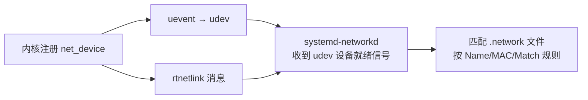
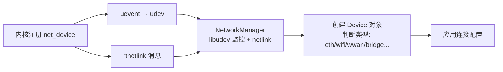

## 添加新网卡驱动的流程

### 1. 先确认硬件信息

```bash
# 查看 PCI Vendor/Device ID
lspci -nn | grep -i ethernet
# 输出示例: 00:1f.6 Ethernet controller [0200]: Intel Corporation Device [8086:0dc6] (rev 11)

# 如果 lspci 看不到，说明 PCI 枚举都没过 → 硬件/BIOS 问题
# 如果能看到但没驱动，走下面
```

### 2. 查内核是否已支持

```bash
# 查 modules.alias 有没有这个 ID
grep -i "8086.*0dc6" /lib/modules/$(uname -r)/modules.alias

# 如果有 → 只是没自动加载
modprobe -c | grep 0dc6
```

### 3. 三种情况

#### 情况 A：内核已有驱动，只是没加载

```bash
# 手动加载
modprobe <driver_name>

# 持久化: 写入 /etc/modules-load.d/<name>.conf
echo "igc" | sudo tee /etc/modules-load.d/igc.conf

# 或者让内核自动匹配 (靠 modules.alias，一般不需要额外配置)
```

#### 情况 B：内核版本太旧，需要 backport 驱动

```bash
# 从厂商或主线内核 backport 驱动源码
# 编译为外部模块
cd <driver_src>
make -C /lib/modules/$(uname -r)/build M=$PWD modules
sudo make -C /lib/modules/$(uname -r)/build M=$PWD modules_install
sudo depmod -a
sudo modprobe <driver_name>
```

#### 情况 C：厂商只提供源码，需要自己编译

```bash
# 典型流程
make
sudo make install
sudo depmod -a
sudo modprobe <driver_name>
```

### 4. 验证

```bash
# 驱动加载成功
lsmod | grep <driver>
dmesg | tail -20          # 看 probe 日志

# 网卡出现
ip link show
# 或
ls /sys/class/net/
```

### 5. 如果驱动要编译进内核 (built-in)

```bash
# 重新编译内核时
Device Drivers →
  Network device support →
    Ethernet driver support →
      <*> Intel(R) IGC Network Driver
```

### 总结

```
新网卡插入
   │
   ▼
lspci 能看到? ──否──→ 硬件/PCIe 问题
   │
   ▼是
modules.alias 有匹配? ──是──→ modprobe 加载即可
   │
   ▼否
厂商提供驱动? ──是──→ make && make install
   │
   ▼否
自己写驱动或换内核
```

## 网络创建流程

### 创建链路

```
驱动 probe() 成功
    │
    ▼
alloc_etherdev() / alloc_netdev()    ← 分配 net_device 结构体
    │
    ▼
register_netdevice(netdev)           ← 注册到内核网络子系统
    │
    ├─ 内核创建 /sys/class/net/eth0/
    │     ├─ addr_assign_type
    │     ├─ address              ← MAC 地址
    │     ├─ carrier              ← 链路状态 (0/1)
    │     ├─ device → ../../pci0000:00/...  ← 指向 PCI 设备
    │     ├─ duplex
    │     ├─ speed
    │     ├─ mtu
    │     ├─ operstate
    │     ├─ statistics/          ← 收发统计
    │     ├─ subsystem → ../../class/net
    │     └─ uevent
    │
    ├─ 发送 uevent (ACTION=add, INTERFACE=eth0)
    │
    └─ 发送 RTM_NEWLINK (rtnetlink 消息)
```

### 代码层面

在 Linux 内核源码 `net/core/net-sysfs.c` 中：

```c
int register_netdevice(struct net_device *dev)
{
    // ... 初始化 ...
    ret = netdev_register_kobject(dev);  // ← 创建 /sys/class/net/<name>
    // ...
}
```

`netdev_register_kobject()` 调用 `device_add()`，后者通过 **kobject** 框架在 sysfs 中创建目录和属性文件。

### 所以整个链路是

```
硬件插上
  → PCI 枚举 (内核)
  → modprobe 加载驱动 (内核触发)
  → 驱动 probe() (驱动代码)
  → register_netdevice() (内核网络核心)
  → /sys/class/net/eth0 出现 (sysfs/kobject)
  → uevent 通知用户态 (udev)
  → NetworkManager/systemd-networkd 收到事件
```

`/sys/class/net/` 是内核暴露网络接口信息的**窗口**，用户态程序（ip、NetworkManager、ifconfig）都是通过读这个目录来发现网卡的。

### 确认网卡工作

```
# 1. 看网卡接口是否存在
ip link show

# 2. 看驱动绑定了哪些设备
ls /sys/bus/pci/drivers/igb/
# 输出: 0000:02:00.0  0000:02:00.1  bind  uevent  unbind
# 有 PCI 地址 = 有设备绑定

# 3. 看设备用了哪个驱动
lspci -k -s 02:00.0
# Kernel driver in use: igb

# 4. 看驱动统计信息
cat /sys/class/net/eth0/device/driver/module/refcnt
```
对，`modprobe` 是加载网卡驱动的关键入口，但需要分清楚**谁触发 modprobe**。

### 完整链条

```
硬件发现 → 内核识别 PCI/USB ID → 触发 modprobe → 驱动 probe → register_netdevice()
```

具体来说：

| 步骤 | 谁做的 |
|---|---|
| 1. 发现 PCI 设备 | **内核 PCI 子系统** (枚举总线，读 Vendor/Device ID) |
| 2. 查找对应驱动 | **内核** 查 `modules.alias` 表 (`pci:v00008086d0000095A...`) |
| 3. 加载驱动 `.ko` | **modprobe** (被内核 `request_module()` 调用，或 udev 触发) |
| 4. 驱动初始化硬件 | **驱动 probe() 函数** (iwlwifi/e1000e/igb 等) |
| 5. 注册网络接口 | **驱动调用 register_netdevice()** → 出现 eth0/wlan0 |

### modprobe 是怎么被触发的

有两种路径：

**路径 A — 内核自动请求 (最常用)**

```
PCI 枚举 → 内核发现未知设备 → request_module("pci:v00008086d...")
                                         ↓
                                  modprobe (用户态)
                                         ↓
                          查找 modules.alias → 加载对应 .ko
                                         ↓
                                  驱动 probe() 被调用
```

内核自己调用 `request_module()`，这是一个内核函数，它会唤起用户态的 `modprobe`（通过 `uevent` + `systemd-modload.service` 或直接 `call_usermodehelper`）。

**路径 B — udev 触发**

```
内核注册设备 → 发送 uevent → udev 收到
                                ↓
                    匹配 udev 规则 (drivers/net/ 相关)
                                ↓
                    执行 modprobe <driver_name>
```

### 所以 modprobe 的角色

```
modprobe <module_name>
     │
     ├─ 解析依赖 (depmod 生成的 modules.dep)
     ├─ 加载 .ko 到内核
     └─ 调用模块的 init 函数 → 驱动 probe
```

**不是 modprobe 添加网卡**，而是 **modprobe 把驱动代码加载进内核**，然后驱动自己去 probe 硬件、注册 net_device。

### 总结

```
硬件插上
   │
   ▼
PCI 总线枚举 (内核)
   │
   ▼
request_module("pci:...") → modprobe → 加载 e1000e.ko
   │
   ▼
驱动 e1000e_probe() → pci_iomap + 初始化 MAC
   │
   ▼
register_netdevice(eth0) → /sys/class/net/eth0 出现
   │
   ▼
uevent → NetworkManager/systemd-networkd 收到 → 开始配 IP
```

**一句话**：`modprobe` 只负责把驱动 `.ko` 文件加载到内核，真正"添加网卡"的是驱动的 `probe()` 函数调用 `register_netdevice()`。如果驱动已经编译进内核（built-in），连 modprobe 都不需要，PCI 枚举后直接 probe。

## 无线网卡的检测

```
PCI/USB 枚举 → 内核驱动 (iwlwifi/ath11k/mt76...) → register_netdevice()
                                                         ↓
                                                  创建 wlan0
                                                  创建 /sys/class/net/wlan0
                                                  发送 uevent + RTM_NEWLINK
```

内核把 `wlan0` 注册为一个普通的 net_device，**此时它只是一个"链路层接口"**，还没有关联到任何 AP。

### wpa_supplicant 的角色

wpa_supplicant 是在**用户态**通过 **nl80211** (netlink 的无线扩展) 与内核无线子系统 (`cfg80211`) 通信的：

```
wpa_supplicant
     │
     ├─ nl80211 socket ←→ 内核 cfg80211 ←→ 驱动 (iwlwifi 等)
     │
     ├─ scan (触发内核扫描信道)
     ├─ 收到 scan results (BSS 列表)
     ├─ 选择 AP (根据 wpa_supplicant.conf)
     ├─ 4-way handshake (EAPOL 密钥协商)
     └─ 通知内核: "关联成功，设置加密密钥"
```

**关键点**：

| 步骤 | 谁做的 |
|---|---|
| 检测到无线网卡硬件 | **内核** (PCI/USB 枚举 → 驱动 probe) |
| 创建 `wlan0` 接口 | **内核** (`register_netdevice()`) |
| 扫描周围 AP | **内核** (驱动扫描信道，上报 BSS) — wpa_supplicant 通过 nl80211 **触发**扫描 |
| 选择 AP、认证、4-way handshake | **wpa_supplicant** |
| 设置加密密钥到硬件 | **内核** (wpa_supplicant 通过 nl80211 下发密钥) |
| 接口进入 `IFF_UP` + `carrier on` | **内核** (关联成功后驱动上报) |

### 所以 NetworkManager 和 wpa_supplicant 的关系是

```
NetworkManager
     │
     ├─ 检测到 wlan0 (通过 udev/netlink)
     ├─ 告诉 wpa_supplicant: "连这个 SSID"
     ├─ wpa_supplicant 做扫描 + 握手
     ├─ 握手成功 → 内核设置密钥
     └─ NetworkManager 检测到 carrier on → 开始 DHCP
```

NetworkManager 不直接碰无线认证，它通过 D-Bus 控制 wpa_supplicant。wpa_supplicant 也不管网卡检测，它只等 NetworkManager 或用户告诉它"去连哪个 AP"。

**一句话**：网卡检测全是内核的事，wpa_supplicant 是纯用户态的 802.11 认证/加密协商工具，它依赖内核的 `cfg80211`/`nl80211` 接口来操作无线硬件。
Optimized tool selection## 三者检测网卡的机制

## 网络栈

### 共同基础：内核层

无论哪个用户态服务，网卡检测的起点都是**内核**：

```
PCI 设备枚举 → 驱动 probe → register_netdevice() → 
  ① 创建 /sys/class/net/<name>
  ② 发送 uevent (NETDEV_REGISTER) 给 udev
  ③ 发送 rtnetlink 消息 (RTM_NEWLINK)
```

用户态服务只需要**读 `/sys/class/net/`** + **监听 netlink/udev**。

---

### 1. 传统 `networking` (ifupdown)


- **启动时**：直接遍历 `/sys/class/net/`，对每个接口检查 `/etc/network/interfaces` 里是否有 `auto <iface>` 或 `allow-hotplug <iface>`
- **热插拔**：依赖 `udev` 的 `RUN+=` 规则触发 `ifup`，或者靠 `ifplugd` 轮询 carrier 状态
- **本质**：最原始，没有持续监控，启动时一次性扫描 sysfs

### 2. systemd-networkd



- **启动时**：`systemd-networkd` 启动后，先扫描 `/sys/class/net/` 获取已有接口，然后通过 `rtnetlink` socket 监听 `RTM_NEWLINK`/`RTM_DELLINK`
- **热插拔**：通过 `systemd-udevd` 的 socket 接收 uevent，同时 netlink 也会推送新接口事件
- **关键**：使用 `sd-device` (libudev 的 systemd 替代品) 获取 udev 数据库中的设备信息（MAC、PCI 路径等），用来匹配 `.network` 文件的 `[Match]` 段

### 3. NetworkManager



- **启动时**：同样先扫描 `/sys/class/net/`，然后通过 **libudev** (`udev_monitor`) + **rtnetlink** 双通道监听
- **热插拔**：udev 监控是主通道，netlink 作为辅助
- **额外**：对 WiFi 通过 `wpa_supplicant` D-Bus 接口检测，对 WWAN 通过 `ModemManager`，对 PPPoE 通过 `pppd`

---

### 总结对比

| 特性 | networking | systemd-networkd | NetworkManager |
|---|---|---|---|
| **初始扫描** | `/sys/class/net/` | `/sys/class/net/` | `/sys/class/net/` |
| **运行时监控** | 无（靠 udev 触发或轮询） | rtnetlink + udev socket | libudev monitor + rtnetlink |
| **设备匹配依据** | `/e/n/interfaces` 的 `auto` | `.network` 文件的 `[Match]` | udev 属性 + 连接配置文件 |
| **热插拔支持** | 弱（需额外工具） | 好 | 最好 |
| **依赖** | ifup/ifdown shell 脚本 | sd-device + netlink | libudev + netlink + D-Bus |

**一句话**：三者都从 `/sys/class/net/` 做初始扫描，但 `networking` 是一次性的 shell 脚本，`systemd-networkd` 和 `NetworkManager` 则是持续监听 netlink/udev 事件的守护进程。区别在于 NetworkManager 更上层，还管理 WiFi/移动宽带等复杂场景的连接切换。